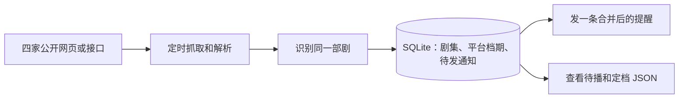

# 国产剧待播与定档提醒：实现方案

## 1. 第一版做什么

一个 Docker 容器，定时读取四家的公开网页数据，把同一部剧合成一张卡片，按平台保留各自的开播时间。**待播用于发现新剧；只在确认定档或改档时发通知。** 不登录、不代点预约、不运行浏览器，也不承诺比 App 推送更早。

## 2. 技术栈：轻量优先

| 部分 | 选型 | 为什么 |
|---|---|---|
| 服务 | 当前受支持的稳定版 Go；标准库负责 HTTP、定时和日志 | 编译成一个程序，不需要 Node.js、Python 或浏览器常驻 |
| 存储 | SQLite，采用无需 C 编译器的 Go 驱动；一个持久化目录 `/data` | 不单独跑数据库；剧集状态和待发通知可以一起保存，容器重启也不丢 |
| 容器 | 多阶段构建，运行镜像只留程序和 HTTPS 证书，以非 root 用户运行 | 运行镜像不带编译器、包管理器和浏览器 |
| 对外 | 只读 `/upcoming`、`/healthz` 和一个通知 Webhook | 不做后台页面，不引入消息队列；默认不把查询接口映射到公网 |

不用 AI 猜剧名，也不为追新引入额外运行时。第一版资源验收目标：**镜像 ≤35 MiB、空闲内存 ≤32 MiB、抓取峰值 ≤96 MiB**。上线前在目标机器上实测镜像大小、空闲和完整抓取周期的内存；这些是目标，不是当前测量结果。

## 3. 四路数据怎么接

| 平台 | 第一版入口 | 留意什么 |
|---|---|---|
| 爱奇艺 | `GET https://www.iqiyi.com/newOnlinePCW`，读取内嵌列表，筛 `cid === 2 && !isOnline` | 读取 `publishText`。内嵌数据有 JavaScript 包装，只解析需要的数据，不执行网页脚本；频道的 `show_time` 可后补，用来补具体时分 |
| 优酷 | `GET https://www.youku.com/ku/webtv`，读「即将上线」的 `itemList` | 用预约 ID（没有时才用平台剧集标识）和 `subtitle`；只解析目标列表，不把整块网页脚本当 JSON |
| 腾讯视频 | 先 `POST getPage` 找 `coming_soon`，再 `POST getCard` 取名单 | 不写死栏目编号。用 `cid`；实测时间字段为空，先当待播，不把宣传副标题当档期 |
| 芒果TV | 首页公开模块接口，读 `vsubscribe` | 用 `aid`；优先用非零 `onlineTime`，保留 `beginTime`。首页混有少儿等内容，分类拿不准时标未知，不冒充国产剧 |

默认每 **10 分钟**查一轮，最多同时查两家，单次请求超时 15 秒；失败按平台退避，不阻塞其他平台。栏目缺失、解析失败、异常空结果记为异常，保留上次数据，不当成全量下架。**网页只覆盖其展示范围；首版不保证补齐腾讯和芒果的国产剧档期。**

## 4. 同一部剧怎么合并

库里分两层：**剧集**负责合并展示；**平台条目**用 `平台 + 平台剧集 ID` 定位，独立保存原始剧名、档期、链接和最近抓取时间。合并不抹掉原始记录。

| 情况 | 处理 |
|---|---|
| 同平台、同剧集 ID | 更新原条目 |
| 配置里明确指定两个平台 ID 属于同一部剧 | 直接合并；可逆，发现误配时改配置即可拆开 |
| 规范化后剧名完全相同，有相同主演等交叉证据，且季数、版本无冲突 | 自动合并；规范化只处理空格、全半角和书名号等格式，不抹掉季数或版本词 |
| 只有同名、证据不足，或存在别名、季数、短剧版冲突 | 不自动合并；同名疑似项在查询结果里标出，用配置按平台 ID 确认，首版不做人工审核后台 |

例如《古乐风华录》这次在腾讯和芒果都抓到了；两边如果只拿到同名、没有交叉证据，就把它列为待确认。确认后展示 **一部《古乐风华录》，下面挂腾讯和芒果两条记录**；即使两家开播时间不同也照实显示。优先避免把两部剧合错，不追求自动合并率。

## 5. 什么时候发通知

| 变化 | 行为 |
|---|---|
| 首次启动已有历史数据 | 第一次成功抓取按平台建立基线，不补发旧通知 |
| 没日期 → 有明确日期 | 发定档通知；同一轮里已合并的同剧多平台消息合成一条 |
| 已知日期或已知时分发生变化 | 发改档通知，写清哪个平台、从什么时候改到什么时候 |
| 同一天补上更准确的时分 | 更新展示，默认不再打扰 |
| 时间字段变空、剧集从列表消失或抓取失败 | 不把它当撤档。只有来源明确显示撤档时，才可单独处理；首版不自动推断 |
| 后一轮才发现另一平台同步 | 同档期更新剧集卡片，不再发一遍定档；档期不同才补发该平台的独立档期 |

时间统一按北京时间解释，保留原文和精度。`明天12:00` 只有在能确认来源日期和新鲜度时才换算成绝对日期；拿不准就暂不推送，避免把缓存里昨天的「明天」误认成后天。只有日期不编造时分，`敬请期待` 不算定档。

剧集状态和待发通知一起存入 SQLite。通知失败重试，固定通知 ID 一并传给接收端；接收端支持按 ID 去重时，可避免“已收到但回执丢失”导致的重复提醒。

## 6. 实现顺序与验收

| 顺序 | 做什么 | 怎么验收 |
|---|---|---|
| 1 | 四个平台解析器、统一时间字段 | 用保存的真实响应做回归测试；再对四家各跑一次实时调用，区分「有数据」「没有可靠档期」「来源异常」 |
| 2 | 跨平台合并和通知判断 | 覆盖同剧同档、同剧不同档、同名不同剧、跨天文案改写、日期补时分、改档和单平台失败 |
| 3 | 打包 Docker、接通知 | 实测资源；容器重启后状态还在，模拟通知失败能重试，不重发已记成功的通知 |
